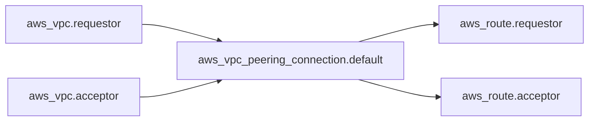

# cloudposse/terraform-aws-vpc-peering

> Terraform module that creates a peering between two AWS VPCs of the same account, for infrastructure teams.

## The problem
Connecting two VPCs requires creating the connection and then manually updating the route tables on both sides.

## What it actually does
Creates the peering connection, accepts it automatically (both VPCs must be in the same account) and adds the routes on the requestor and acceptor sides. VPCs are designated by identifier or by tags. Some CIDRs can be ignored.

## How it is wired


## Trying it
```bash
atmos test run
atmos test clean
atmos test --help
```

## Cost and gotchas
You need an AWS account, Terraform 1.3 or later and the aws provider 5.0 or later. Pin a module version rather than `master`.

## What it is not
Not for VPCs in different accounts: the README points to other modules. It does not create the VPCs.

## Alternatives
- terraform-aws-vpc: creates the VPC itself, to use upstream.
- terraform-aws-kops-vpc-peering: preferable for a VPC created by Kops.

## For you
Ignore: an AWS network building block unrelated to data or AI, to open only if you connect VPCs yourself.
