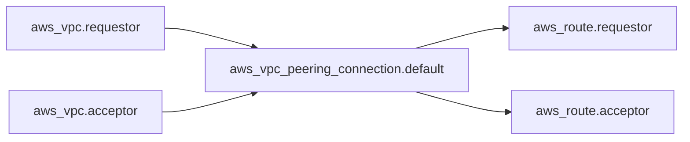

# cloudposse/terraform-aws-vpc-peering

> Module Terraform qui crée un peering entre deux VPC AWS du même compte, pour les équipes infra.

## Le problème
Relier deux VPC demande de créer la connexion puis de mettre à jour à la main les tables de routage des deux côtés.

## Ce que ça fait vraiment
Crée la connexion de peering, l'accepte automatiquement (les deux VPC doivent être dans le même compte) et ajoute les routes côté requestor et acceptor. Les VPC se désignent par identifiant ou par tags. Des CIDR peuvent être ignorés.

## Comment c'est branché


## Essayer
```bash
atmos test run
atmos test clean
atmos test --help
```

## Coût et pièges
Il faut un compte AWS, Terraform 1.3 ou plus et le provider aws 5.0 ou plus. Épingler une version du module plutôt que `master`.

## Ce que ce n'est pas
Pas pour des VPC de comptes différents : le README renvoie vers d'autres modules. Il ne crée pas les VPC.

## Alternatives
- terraform-aws-vpc : crée le VPC lui-même, à utiliser en amont.
- terraform-aws-kops-vpc-peering : à préférer pour un VPC créé par Kops.

## Pour toi
À ignorer : brique réseau AWS sans lien avec la donnée ou l'IA, à n'ouvrir que si tu relies toi-même des VPC.

