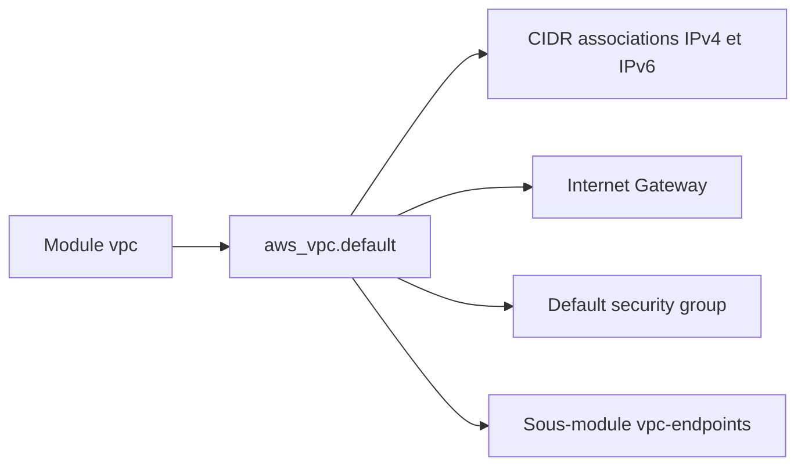

# cloudposse/terraform-aws-vpc

> Terraform module that creates an AWS VPC with an Internet gateway and a submodule for endpoints.

## The problem
A ready-to-use VPC needs consistent IPv4 and IPv6 CIDRs, gateways, a route table and DNS settings.

## What it actually does
The module creates the VPC, the Internet gateway, the optional IPv6 egress-only gateway, and can empty the rules of the default network ACL, route table and security group. It supports additional CIDR blocks, with or without IPAM. A `vpc-endpoints` submodule creates interface and gateway endpoints (for example S3).

## How it is wired


## Trying it
```hcl
module "vpc" {
  source = "cloudposse/vpc/aws"
  namespace = "eg"
  stage     = "test"
  name      = "app"
  ipv4_primary_cidr_block = "10.0.0.0/16"
  assign_generated_ipv6_cidr_block = true
}
```

## Cost and gotchas
Free; a VPC alone is cheap, the resources deployed inside it are not. You must set `ipv4_primary_cidr_block` or its IPAM association, not both. `assign_generated_ipv6_cidr_block` defaults to `true`.

## What it is not
Not a subnet module: the README points to `terraform-aws-dynamic-subnets` for that. It also contains a lot of advertising for Cloud Posse's services.

## Alternatives
terraform-aws-dynamic-subnets, terraform-aws-multi-az-subnets, terraform-aws-named-subnets (cited in the README).

## For you
Worth watching: a clean networking building block for hosting AWS workloads, but pick it only if you already use Cloud Posse conventions.
