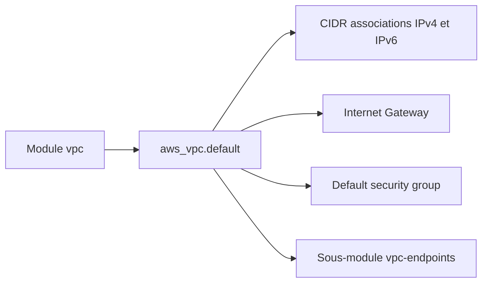

# cloudposse/terraform-aws-vpc

> Module Terraform qui crée un VPC AWS avec passerelle Internet et sous-module pour les endpoints.

## Le problème
Un VPC prêt à l'emploi demande CIDR IPv4 et IPv6, passerelles, table de routage et réglages DNS cohérents.

## Ce que ça fait vraiment
Le module crée le VPC, la passerelle Internet, la passerelle sortante IPv6 optionnelle, et peut vider les règles du réseau ACL, de la table de routage et du groupe de sécurité par défaut. Il supporte des blocs CIDR supplémentaires, avec ou sans IPAM. Un sous-module `vpc-endpoints` crée des endpoints d'interface et de passerelle (par exemple S3).

## Comment c'est branché


## Essayer
```hcl
module "vpc" {
  source = "cloudposse/vpc/aws"
  namespace = "eg"
  stage     = "test"
  name      = "app"
  ipv4_primary_cidr_block = "10.0.0.0/16"
  assign_generated_ipv6_cidr_block = true
}
```

## Coût et pièges
Gratuit ; un VPC seul est peu coûteux, les ressources déployées dedans non. Il faut renseigner `ipv4_primary_cidr_block` ou son association IPAM, pas les deux. `assign_generated_ipv6_cidr_block` vaut `true` par défaut.

## Ce que ce n'est pas
Pas un module de sous-réseaux : le README renvoie vers `terraform-aws-dynamic-subnets` pour cela. Il contient aussi beaucoup de publicité pour les services de Cloud Posse.

## Alternatives
terraform-aws-dynamic-subnets, terraform-aws-multi-az-subnets, terraform-aws-named-subnets (cités dans le README).

## Pour toi
Surveiller : brique réseau propre pour héberger des charges AWS, mais à choisir seulement si tu utilises déjà les conventions Cloud Posse.

