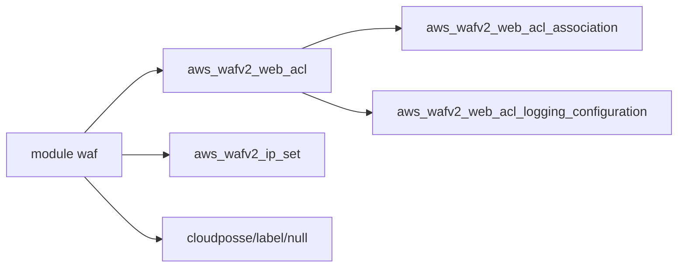

# cloudposse/terraform-aws-waf

> Terraform module that creates and manages AWS WAFv2 ACLs with many rule types.

## The problem
Hand-writing a WAFv2 ACL with rules, IP sets, logging and resource association is verbose.

## What it actually does
Creates a WAFv2 web ACL, IP address sets, the association to resources (load balancer, API Gateway, AppSync) and the logging configuration. Rules are declared by type: geography, IP, byte match, managed groups, AND combinations. The default action is `block`.

## How it is wired
Simplified diagram based on the sheet, no diagram provided.



## Trying it
```bash
atmos test run
atmos test clean
```
The usage example is an HCL block with `source = "cloudposse/waf/aws"` and `examples/complete`.

## Cost and gotchas
AWS account required, `aws >= 6.2.0` provider. WAF and logging are billed by AWS. The README was truncated in the material read: the end of the inputs list was not seen.

## What it is not
Not a standalone firewall: it drives AWS WAFv2. For CloudFront, the ACL is attached via `web_acl_id` and not through this module.

## Alternatives
No alternative named in the README.

## For you
Worth watching: useful if you expose model APIs behind an AWS ALB with Terraform, otherwise off topic.
