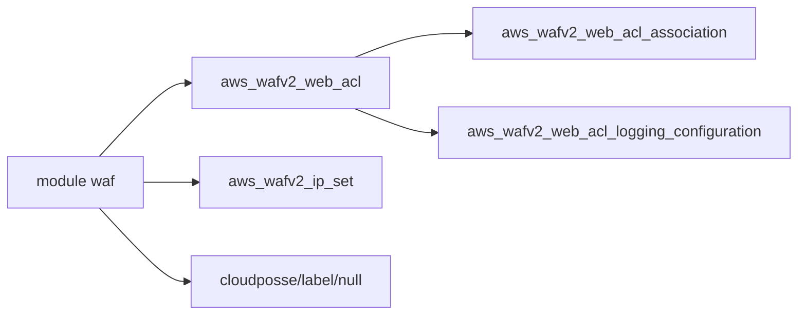

# cloudposse/terraform-aws-waf

> Module Terraform qui crée et gère des ACL AWS WAFv2 avec de nombreux types de règles.

## Le problème
Écrire à la main une ACL WAFv2 avec règles, jeux d'IP, journalisation et association aux ressources est verbeux.

## Ce que ça fait vraiment
Crée une web ACL WAFv2, des jeux d'adresses IP, l'association à des ressources (load balancer, API Gateway, AppSync) et la configuration de journalisation. Les règles se déclarent par type : géographie, IP, correspondance d'octets, groupes gérés, combinaisons ET. L'action par défaut est `block`.

## Comment c'est branché
Schéma simplifié d'après la fiche, sans diagramme fourni.



## Essayer
```bash
atmos test run
atmos test clean
```
L'exemple d'usage est un bloc HCL avec `source = "cloudposse/waf/aws"` et `examples/complete`.

## Coût et pièges
Compte AWS requis, provider `aws >= 6.2.0`. WAF et la journalisation sont facturés par AWS. Le README était tronqué dans la matière lue : la fin de la liste des entrées n'a pas été vue.

## Ce que ce n'est pas
Pas un pare-feu autonome : il pilote WAFv2 d'AWS. Pour CloudFront, l'ACL se relie via `web_acl_id` et non par ce module.

## Alternatives
Aucune alternative nommée dans le README.

## Pour toi
À surveiller : sert si tu exposes des API de modèles derrière un ALB AWS en Terraform, sinon hors sujet.

