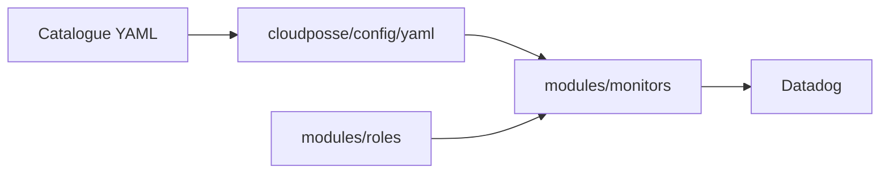

# cloudposse/terraform-datadog-platform

> Terraform modules to provision Datadog monitors, synthetics, roles and SLOs from YAML files.

## The problem
Datadog monitors and roles created by hand in the interface drift and cannot be versioned.

## What it actually does
Seven submodules: monitors, synthetics, permissions, roles, slo, child_organization, organization_settings. Definitions live in a catalog of YAML files read via `cloudposse/config/yaml`, then passed to the modules. Roles can restrict access to certain monitors.

## How it is wired
Simplified diagram based on the sheet, no diagram provided.



## Trying it
```bash
atmos test run
atmos test clean
atmos test --help
```

## Cost and gotchas
A paid Datadog account is required (multi-organization must be requested from support). A child organization created by Terraform cannot be destroyed by it: you have to contact support.

## What it is not
Not a monitoring tool: it only describes Datadog resources. The commands above are those of the tests, not of deployment.

## Alternatives
- terraform-aws-datadog-integration: to connect AWS to Datadog.

## For you
Adopt if you monitor your ML pipelines with Datadog: monitors and SLOs become reviewed code. Without Datadog, no interest.
