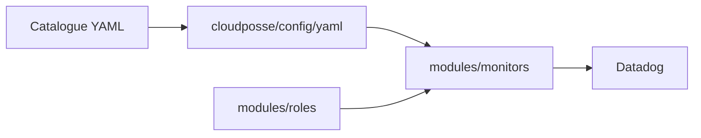

# cloudposse/terraform-datadog-platform

> Modules Terraform pour provisionner monitors, synthetics, rôles et SLO Datadog depuis des fichiers YAML.

## Le problème
Les monitors et rôles Datadog créés à la main dans l'interface dérivent et ne se versionnent pas.

## Ce que ça fait vraiment
Sept sous-modules : monitors, synthetics, permissions, roles, slo, child_organization, organization_settings. Les définitions vivent dans un catalogue de fichiers YAML lus via `cloudposse/config/yaml`, puis passés aux modules. Les rôles peuvent restreindre l'accès à certains monitors.

## Comment c'est branché
Schéma simplifié d'après la fiche, sans diagramme fourni.



## Essayer
```bash
atmos test run
atmos test clean
atmos test --help
```

## Coût et pièges
Il faut un compte Datadog payant (la multi-organisation se demande au support). Une organisation enfant créée par Terraform ne peut pas être détruite par lui : il faut contacter le support.

## Ce que ce n'est pas
Pas un outil de monitoring : il ne fait que décrire des ressources Datadog. Les commandes ci-dessus sont celles des tests, pas du déploiement.

## Alternatives
- terraform-aws-datadog-integration : pour brancher AWS à Datadog.

## Pour toi
Adopter si tu supervises tes pipelines ML avec Datadog : monitors et SLO deviennent du code relu. Sans Datadog, aucun intérêt.

