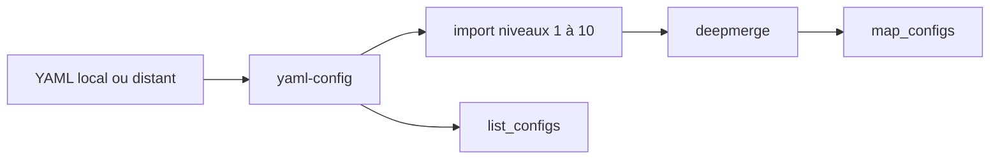

# cloudposse/terraform-yaml-config

> Terraform module that turns local or remote YAML files into lists and maps, with merged imports.

## The problem
Keeping configuration in YAML files while consuming it in Terraform requires writing reading and merging code.

## What it actually does
It reads local or remote YAML paths, interpolates parameters, follows an `import` attribute up to ten levels deep and deep-merges the maps. The outputs are `map_configs`, `list_configs`, `all_imports_map` and `all_imports_list`.

## How it is wired
Simplified diagram based on the sheet, no diagram provided.



## Trying it
```hcl
module "yaml_config" {
  source = "cloudposse/config/yaml"
  map_config_local_base_path = "./config"
  map_config_paths = ["map-configs/*.yaml"]
  context = module.this.context
}
```
Tests: `atmos test run`.

## Cost and gotchas
Terraform 0.13 or later, `http`, `local` and `template` providers. The `template` provider is old. Pin the module version.

## What it is not
It is not a standalone tool. The README contains a lot of advertising for Cloud Posse's consulting offer.

## Alternatives
- terraform-datadog-monitor: a module from the same publisher that relies on a YAML config.
- Deepmerge: a module cited for merging maps.

## For you
Watch: useful for YAML-driven infrastructure, but the `template` provider is aging.
