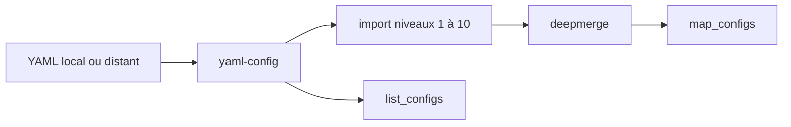

# cloudposse/terraform-yaml-config

> Module Terraform qui transforme des fichiers YAML locaux ou distants en listes et maps, avec imports fusionnés.

## Le problème
Garder la configuration dans des fichiers YAML tout en la consommant dans Terraform oblige à écrire du code de lecture et de fusion.

## Ce que ça fait vraiment
Il lit des chemins YAML locaux ou distants, interpole des paramètres, suit un attribut `import` jusqu'à dix niveaux et fusionne en profondeur les cartes. Les sorties sont `map_configs`, `list_configs`, `all_imports_map` et `all_imports_list`.

## Comment c'est branché
Schéma simplifié d'après la fiche, sans diagramme fourni.



## Essayer
```hcl
module "yaml_config" {
  source = "cloudposse/config/yaml"
  map_config_local_base_path = "./config"
  map_config_paths = ["map-configs/*.yaml"]
  context = module.this.context
}
```
Tests : `atmos test run`.

## Coût et pièges
Terraform 0.13 ou plus, fournisseurs `http`, `local` et `template`. Le fournisseur `template` est ancien. Épingler la version du module.

## Ce que ce n'est pas
Ce n'est pas un outil autonome. Le README contient beaucoup de publicité pour l'offre de conseil de Cloud Posse.

## Alternatives
- terraform-datadog-monitor : module du même éditeur qui s'appuie sur une config YAML.
- Deepmerge : module cité pour la fusion de maps.

## Pour toi
Surveiller : utile pour une infra pilotée par YAML, mais le fournisseur `template` vieillit.

