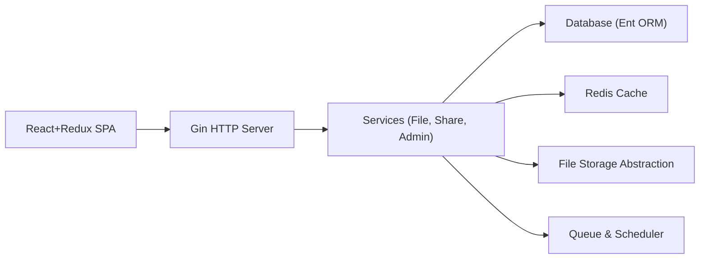

# cloudreve/Cloudreve

> Self-hosted, multi-user file management system with local or multiple cloud storage.

## The problem
Hosting your own files with sharing, preview and WebDAV means assembling several tools, and each storage provider has its own API.

## What it actually does
Go server (Gin, Ent) with an embedded React front end. A storage abstraction layer (pkg/filemanager) drives local disk, a remote node, OneDrive, S3, Qiniu, OSS, COS, OBS, KS3 or Upyun. It adds background downloads via Aria2/qBittorrent, WebDAV, share links with expiration, user groups and online document editing.

## How it is wired

## Trying it
The README provides no command; it points to the "Getting started" documentation for local deployment, and to "Build" for compiling from source.

## Cost and gotchas
Free in itself; the chosen cloud storage remains at your expense. The README does not detail installation prerequisites. GPL-3.0 license: redistribution constraints if you modify and distribute it.

## What it is not
It is not a data or ML tool. It is not a simple file explorer: it ships a database, a cache and a task queue to operate.

## Alternatives
- No alternative named in the README.

## For you
Watch: useful for self-hosted team file sharing, but outside the data/AI core; evaluate only if you have this infrastructure need.
