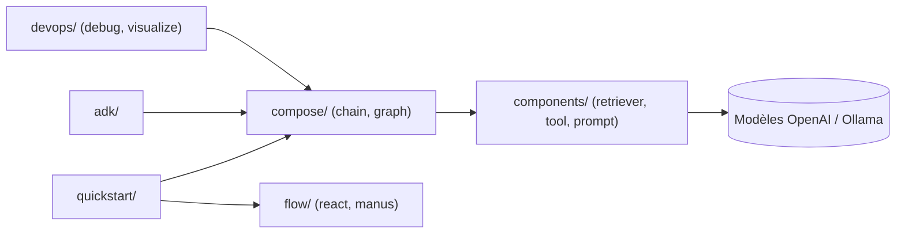

# cloudwego/eino-examples

> Collection of Go examples for the Eino LLM agent framework: agents, orchestration, RAG and tools.

## The problem
Learning an agent framework requires runnable examples covering agents, orchestration graphs and components, not just an API reference.

## What it actually does
Organizes examples by theme: ADK (agents, workflows, handoff, human in the loop, multi-agent), compose (chains, graphs, workflows), flow (ReAct, Manus, Deer-Go), components (retrievers, tools, MCP, parsers) and quickstart (chat, full RAG assistant, Todo agent, 11-chapter tutorial). Debugging tools and Mermaid visualization are included.

## How it is wired

## Trying it
The README gives no command: each example is described in COOKBOOK.md.

## Cost and gotchas
The examples call LLMs (OpenAI, Ollama according to the code): keys and bill are on you. The Eino assistant relies on Redis or memory.

## What it is not
It is not the framework itself (`cloudwego/eino` repository) nor a ready-to-deploy application.

## Alternatives
- cloudwego/eino-ext: framework extensions.
- cloudwego/eino: the base framework.

## For you
Worth watching: a good source of examples if you build agents in Go; of little use if your stack is Python.
