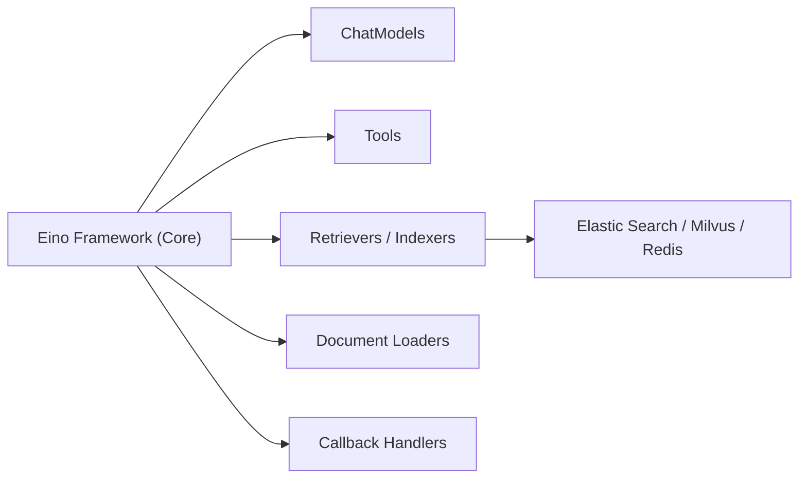

# cloudwego/eino-ext

> Official extensions for the Go framework Eino: models, tools, retrievers, loaders and callbacks for LLM applications.

## The problem
An LLM framework is useless without concrete implementations of models, vector databases and tools.

## What it actually does
A repository of Go modules, one per Eino component type: ChatModel (OpenAI, Claude, Gemini, Ark, Ollama...), Tool (Google Search, DuckDuckGo...), Retriever and Indexer (Elasticsearch, Milvus, Redis, VikingDB), Embedding, Document Loader (S3, URL, file), Transformer. Also contains callbacks (Langfuse tracing) and DevOps tools (IDE plugin for visual debugging).

## How it is wired

## Trying it
No commands documented in the README.

## Cost and gotchas
Each implementation requires its third-party service (API keys, databases); 124 open issues. The README details neither installation nor examples.

## What it is not
Not the Eino framework itself, which lives elsewhere; not usable on its own. These are Go modules.

## Alternatives
No alternative cited in the README.

## For you
Ignore unless you are already building on Eino in Go: without that framework, these extensions have no use of their own.
