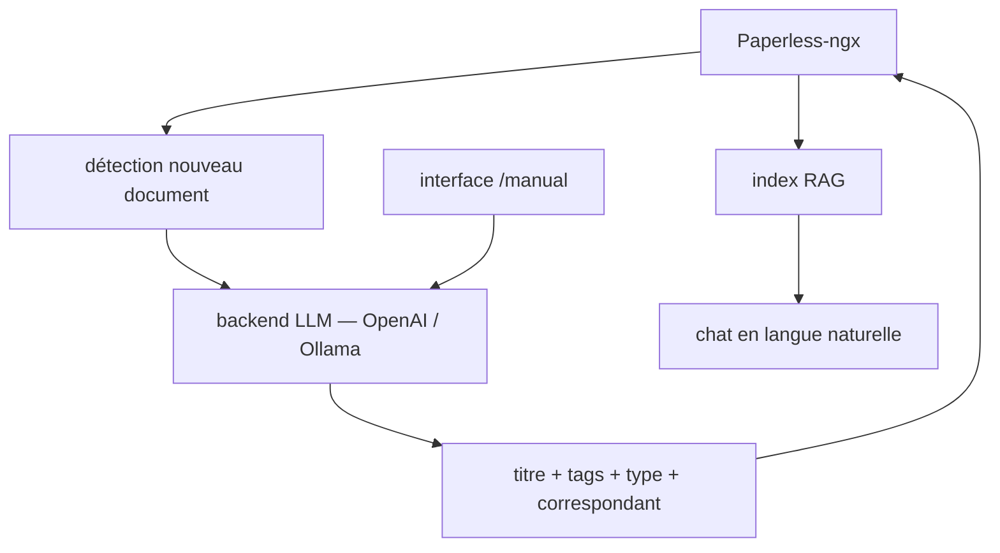

# clusterzx/paperless-ai

> Paperless-ngx extension that classifies, tags and queries your documents through an LLM.

## The problem
Paperless-ngx archives documents but leaves the title, tags, type and correspondent to be filled in by hand.
Finding "the amount of the last electricity bill" requires knowing the exact keyword.

## What it actually does
It detects new documents in Paperless-ngx, analyzes the content and automatically assigns title, tags, type and correspondent.
Accepted backends are OpenAI-compatible or Ollama: Mistral, Llama, Phi-3, Gemma-2, DeepSeek, OpenRouter, Perplexity, Together, LiteLLM, VLLM, Fastchat, Gemini.
A RAG chat answers in natural language across the whole archive, with the full context of the document rather than keywords.
A manual mode (`/manual`) lets you process sensitive documents one by one, and rules limit the scope processed.

## How it is wired


## Trying it
```bash
# développement local
npm install
npm run test
```
Production installation is not documented in the README: it points to the wiki. A container restart after configuration is required to build the RAG index.

## Cost and gotchas
Each processed document is an LLM call: with OpenAI the bill follows the archive volume, Ollama brings it down to zero but requires a machine.
A working Paperless-ngx is a hard prerequisite, and the first startup requires a manual container restart.

## What it is not
It is not a living project: the maintainer states at the top of the README that they no longer provide follow-up, that they are rewriting the codebase in the evenings and that they are not sure they will finish.
Nor is it a replacement for Paperless-ngx, which is preparing its own official AI integration — mentioned by the author as a possible reason to stop.

## Alternatives
- Paperless-ngx itself: its official AI integration is announced in the README as the likely successor.
- Ollama: cited as a local backend, if the goal is to avoid sending documents to a third party.

## For you
Set aside: the README announces abandonment and upstream is preparing the same feature; keep the idea, not the repository.
