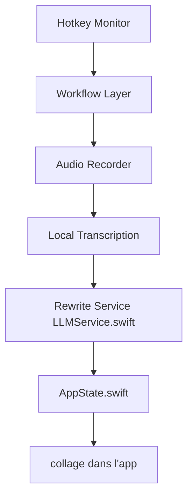

# cmagnussen/blitztext-app

> Local dictation for Mac: hold a shortcut, speak, and the text is pasted at the cursor.

## The problem
Dictation tools send your voice to the cloud; those that stay local don't clean up the text.

## What it actually does
Menu bar app in Swift. Local transcription with Parakeet or Whisper (WhisperKit, Core ML). Four modes: exact text, clean text, softened message, text with emojis, rewritten by Apple Intelligence (macOS 26) or by the provider of your choice. Per-app mode, dictionary, encrypted history, meeting transcription with speakers and summary, local Gemma 4 in beta.

## How it is wired


## Trying it
```bash
git clone https://github.com/cmagnussen/blitztext-app.git
cd blitztext-app
./build.sh --install --run
```

## Cost and gotchas
Free. Xcode 26 and XcodeGen to build. Parakeet model of about 630 MB; 16 GB of memory for Gemma E4B. Accessibility and microphone permissions required. Interface in German.

## What it is not
Not cross-platform: macOS only, Parakeet on Apple Silicon. The local writing modes require macOS 26.

## Alternatives
No alternative named in the README.

## For you
Worth watching: a good showcase of privacy-respecting local AI on Mac, useful if you dictate a lot, but German-language interface and Mac-only scope.
