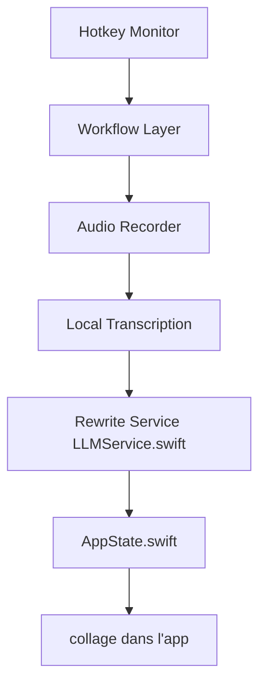

# cmagnussen/blitztext-app

> Dictée locale pour Mac : on maintient un raccourci, on parle, le texte se colle au curseur.

## Le problème
Les outils de dictée envoient la voix vers le cloud ; ceux qui restent locaux ne nettoient pas le texte.

## Ce que ça fait vraiment
App de barre de menus en Swift. Transcription locale avec Parakeet ou Whisper (WhisperKit, Core ML). Quatre modes : texte exact, texte propre, message apaisé, texte avec emojis, réécrits par Apple Intelligence (macOS 26) ou par le fournisseur de ton choix. Mode par application, dictionnaire, historique chiffré, transcription de réunions avec locuteurs et résumé, Gemma 4 local en bêta.

## Comment c'est branché


## Essayer
```bash
git clone https://github.com/cmagnussen/blitztext-app.git
cd blitztext-app
./build.sh --install --run
```

## Coût et pièges
Gratuit. Xcode 26 et XcodeGen pour compiler. Modèle Parakeet d'environ 630 Mo ; 16 Go de mémoire pour Gemma E4B. Accessibilité et micro à autoriser. Interface en allemand.

## Ce que ce n'est pas
Pas multiplateforme : macOS seulement, Parakeet sur Apple Silicon. Les modes d'écriture locaux exigent macOS 26.

## Alternatives
Aucune alternative nommée dans le README.

## Pour toi
À surveiller : bonne vitrine d'IA locale respectueuse de la vie privée sur Mac, utile si tu dictes beaucoup, mais interface germanophone et périmètre Mac.

