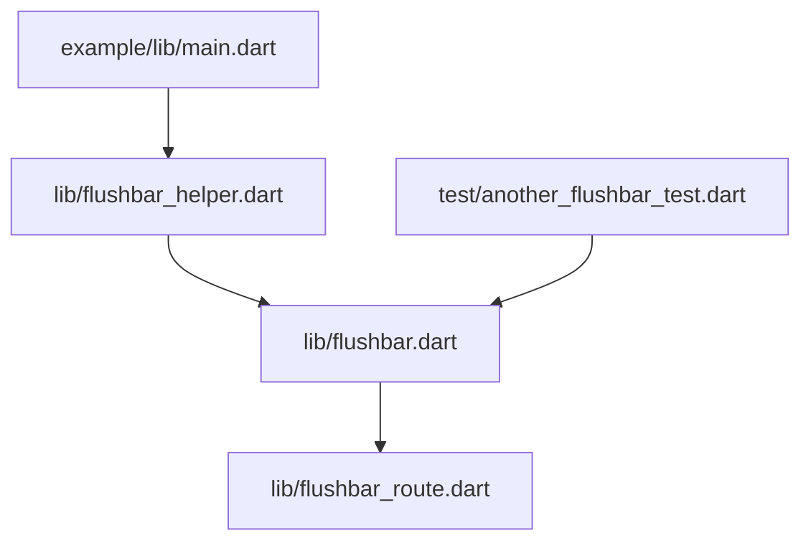

# cmdrootaccess/another-flushbar

> Flutter package of customizable notifications, replacing toasts and snackbars.

## The problem
Flutter's snackbars offer little visual customization.

## What it actually does
`Flushbar` shows a notification at the top or bottom, floating or stuck to the edge. It accepts a title, message, icon, button, gradient, shadow, progress indicator and input form. `show()` returns a Future resolved by `dismiss(result)`. `FlushbarHelper` provides ready-made templates (success, error, loading).

## How it is wired
Diagram based on the code's diagram.



## Trying it
```bash
# Pas de commande : ajouter le paquet au pubspec.yaml, puis
# Flushbar(title: "Hey Ninja", message: "...", duration: Duration(seconds: 3))..show(context);
```

## Cost and gotchas
Free. Last push in October 2023; the examples use `FlatButton`, an old Flutter component, and were written for version 1.3.0.

## What it is not
Not a push notification system: only an in-app bar.

## Alternatives
None cited in the README.

## For you
Ignore: an aging mobile UI component, unrelated to data / AI / MLOps work.
