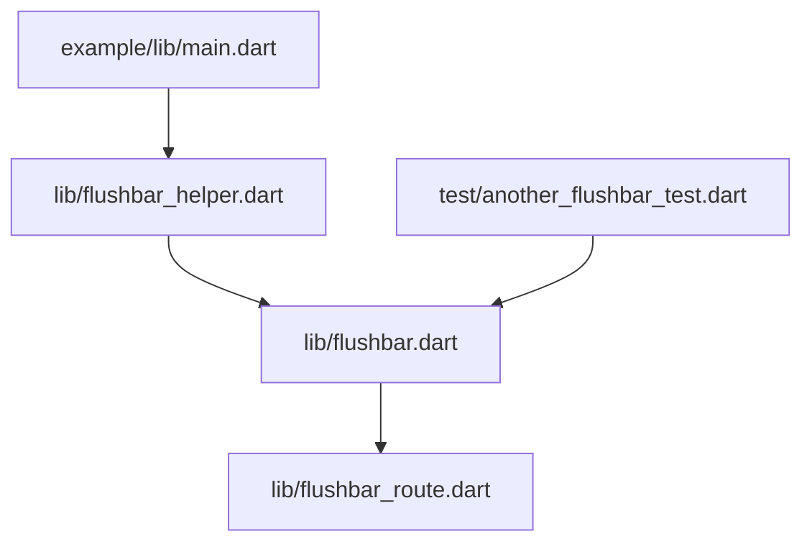

# cmdrootaccess/another-flushbar

> Paquet Flutter de notifications personnalisables, en remplacement des toasts et snackbars.

## Le problème
Les snackbars de Flutter offrent peu de personnalisation visuelle.

## Ce que ça fait vraiment
`Flushbar` affiche une notification en haut ou en bas, flottante ou collée au bord. Elle accepte titre, message, icône, bouton, dégradé, ombre, indicateur de progression et formulaire de saisie. `show()` renvoie un Future résolu par `dismiss(result)`. `FlushbarHelper` donne des modèles prêts (succès, erreur, chargement).

## Comment c'est branché
Schéma d'après le diagramme du code.



## Essayer
```bash
# Pas de commande : ajouter le paquet au pubspec.yaml, puis
# Flushbar(title: "Hey Ninja", message: "...", duration: Duration(seconds: 3))..show(context);
```

## Coût et pièges
Gratuit. Dernier push en octobre 2023 ; les exemples utilisent `FlatButton`, ancien composant Flutter, et ont été écrits pour la version 1.3.0.

## Ce que ce n'est pas
Pas un système de notifications push : uniquement une barre dans l'application.

## Alternatives
Aucune citée dans le README.

## Pour toi
Ignorer : composant d'interface mobile, vieillissant, sans lien avec un travail data / IA / MLOps.

