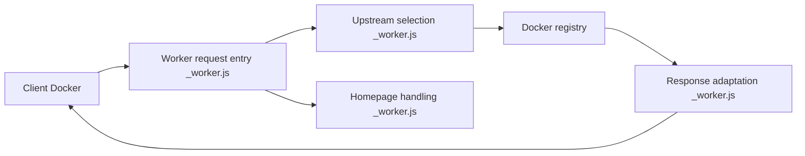

# cmliu/CF-Workers-docker.io

> Cloudflare Worker that relays requests to Docker registries, to bypass access restrictions.

## The problem
In some regions, Docker Hub and other registries are slow or unreachable. A personal mirror makes it possible to pull images.

## What it actually does
A `_worker.js` file receives requests from a Docker client, picks the upstream registry (based on the path or hostname), then adapts the response. Variables control the home page (302 redirect, fake site, User-Agent filtering). The README adds Docker, containerd and Podman config examples, and a list of unverified third-party mirrors.

## How it is wired


## Trying it
```bash
docker pull docker.fxxk.dedyn.io/library/nginx:stable-alpine3.19-perl
```
The example domain is reported as polluted: deploy your own Worker (copy of `_worker.js` or a Pages deployment from a fork).

## Cost and gotchas
Cloudflare account required. The README warns that proxy-style usage may violate Cloudflare's terms (risk of suspension), and that hostname mode may get the domain classified as phishing.

## What it is not
Not a managed service: repository archived since 2025, no declared license, so reuse rights are unclear. The listed mirrors have undergone no security review.

## Alternatives
- The third-party mirrors listed in the README (DaoCloud, 1panel...): nothing to deploy, but trust must be granted.

## For you
Ignore: archived, unlicensed and risky with regard to Cloudflare's terms; an official or internal mirror registry suits an MLOps chain better.
