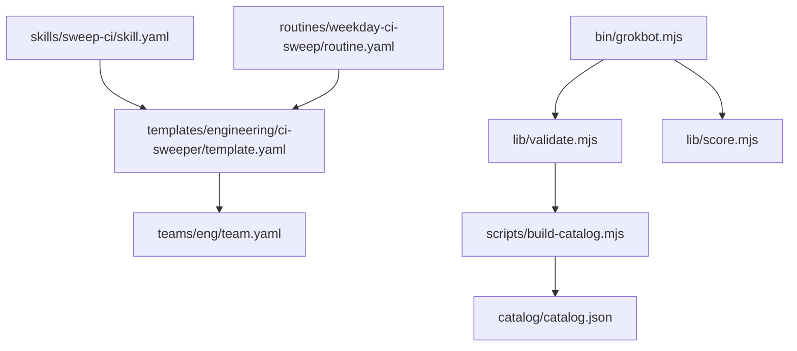

# cobusgreyling/grok-bot-templates

> Catalog of profiles to paste into Grok Bot, with a maturity score, for users of that product.

## The problem
Configuring a long-lived assistant (role, limits, routines) from scratch gives uneven results.

## What it actually does
49 Bot templates, 10 teams, 47 skills and 8 routines in YAML, with a Node CLI (`list`, `init`, `score`, `validate`, `catalog`, `new`). A "Bot Ready" score out of 100 rates each contract; the bar is 80. You paste a `PROFILE.md` into Grok Bot, the default autonomy level is L1 (drafts).

## How it is wired


## Trying it
```bash
npx --yes github:cobusgreyling/grok-bot-templates list
npx --yes github:cobusgreyling/grok-bot-templates init pr-reviewer --print
npx --yes github:cobusgreyling/grok-bot-templates score pr-reviewer --badge
```

## Cost and gotchas
A Grok Bot account (an xAI product) is required, with its possible fees. The project is not affiliated with xAI.

## What it is not
Not agent software: these are contract texts. No use outside Grok Bot.

## Alternatives
None cited in the README (it calls itself a companion to loop-engineering and outerloop).

## For you
Ignore: only useful if you use Grok Bot; the job, limit, skill, routine method remains transferable, but the repo is tied to a specific product.
