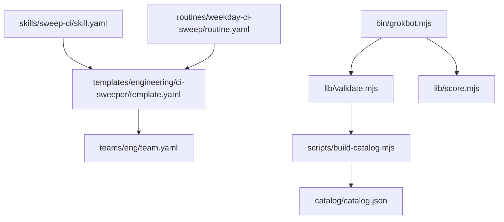

# cobusgreyling/grok-bot-templates

> Catalogue de profils à coller dans Grok Bot, avec score de maturité, pour utilisateurs de ce produit.

## Le problème
Configurer un assistant durable (rôle, limites, routines) à partir de rien donne des résultats inégaux.

## Ce que ça fait vraiment
49 modèles de Bots, 10 équipes, 47 compétences et 8 routines en YAML, avec un CLI Node (`list`, `init`, `score`, `validate`, `catalog`, `new`). Un score « Bot Ready » sur 100 note chaque contrat ; la barre est 80. On colle un `PROFILE.md` dans Grok Bot, le niveau d'autonomie par défaut est L1 (brouillons).

## Comment c'est branché


## Essayer
```bash
npx --yes github:cobusgreyling/grok-bot-templates list
npx --yes github:cobusgreyling/grok-bot-templates init pr-reviewer --print
npx --yes github:cobusgreyling/grok-bot-templates score pr-reviewer --badge
```

## Coût et pièges
Un compte Grok Bot (produit xAI) est requis, avec ses éventuels frais. Le projet n'est pas affilié à xAI.

## Ce que ce n'est pas
Pas un logiciel d'agent : ce sont des textes de contrats. Aucun usage hors de Grok Bot.

## Alternatives
Aucune citée dans le README (il se dit compagnon de loop-engineering et outerloop).

## Pour toi
À ignorer : ne sert que si tu utilises Grok Bot ; la méthode job, limite, compétence, routine reste transposable, mais le dépôt est lié à un produit précis.

