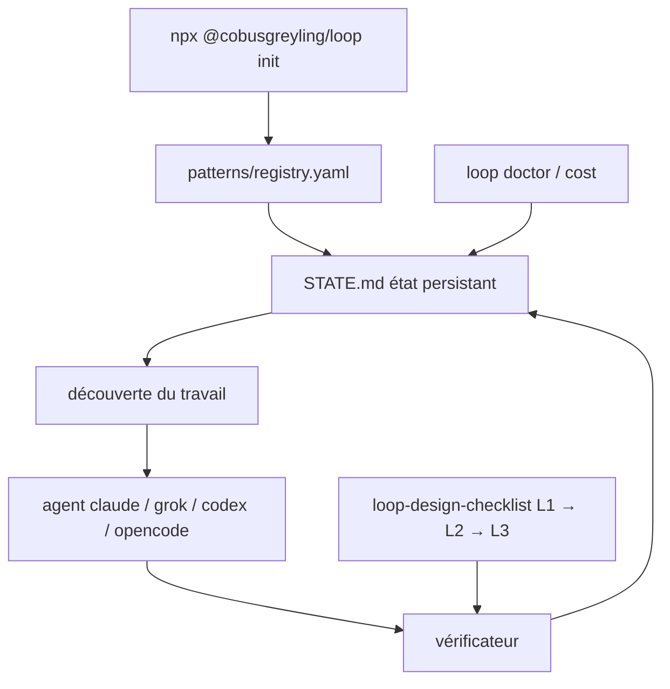

# cobusgreyling/loop-engineering

> Library of patterns for running agents around a repository, with graduated autonomy.

## The problem
Driving a coding agent often boils down to typing the next prompt, with no discovery of the work and no verification.
Letting an agent loose without guardrails makes token costs explode and produces unmonitored errors.

## What it actually does
Provides documented patterns — Daily Triage, Thin loop, PR Babysitter, CI Sweeper, Dependency Sweeper, Changelog Drafter, Post-Merge Cleanup, Issue Triage — with announced cadence, week-1 level and cost.
A single CLI `npx @cobusgreyling/loop` exposes `init`, `doctor`, `status`, `audit`, `cost`.
Progression is explicit: L1 report, L2 assisted, L3 unattended, and only after a week of a correct verifier.
The "Loop Ready" score weighs recent runs more heavily than files on disk: a 30-day-old `STATE.md` is not L3.

## How it is wired


## Trying it
```bash
npx @cobusgreyling/loop init . --pattern daily-triage --tool claude
npx @cobusgreyling/loop doctor .
npx @cobusgreyling/loop cost --pattern daily-triage --level L1
```

## Cost and gotchas
The repository is free; the real cost is in tokens, and the README warns it can explode — hence the `cost` command.
Two patterns are marked "High" and "Very high" (PR Babysitter, CI Sweeper): not to be launched blindly.

## What it is not
Not a "rewrite the module" button: the README says so explicitly, it is a library of operating patterns.
Not a tool that guarantees the result: unmonitored loops make unmonitored errors, according to the Safety page.
Not a set to install in full — the companion repositories are to be left aside until a loop has run.

## Alternatives
- memory-engineering, harness-foundry, outerloop, fleet-engineering, goal-engineering: companion repositories by the same author, for later.

## For you
Worth reading for the L1 → L3 discipline and the cost estimation, before automating anything with an agent.
