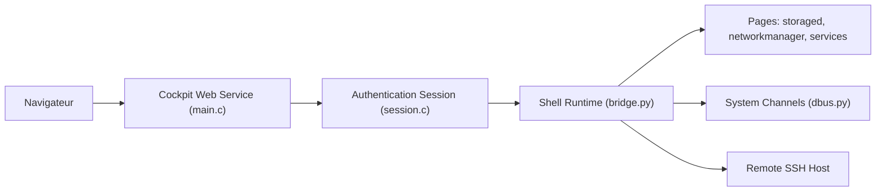

# cockpit-project/cockpit

> Web interface for administering Linux servers, which opens a real system session in the browser.

## The problem
Administering a server (services, storage, network, logs, containers) forces you to juggle between the terminal and disparate tools.

## What it actually does
Cockpit exposes administration pages in the browser: services and logs, storage, network configuration, accounts, applications, metrics, kdump, SELinux troubleshooting. They drive the system through a bridge (`bridge.py`) and D-Bus channels; the web service authenticates, then you can add other Cockpit machines over SSH. Terminal and web stay consistent: a service started on one side is visible on the other.

## How it is wired

## Trying it
No command documented: the README says Cockpit is packaged as `cockpit` in many distributions and points to the installation guide on the project site; a Flatpak client "Cockpit Client" exists.

## Cost and gotchas
Free. Some systems require extra work (see the project FAQ). A web administration console opens an attack surface: read SECURITY.md before exposing the service.

## What it is not
It is not a multi-cluster orchestration tool nor ML monitoring. It is a per-machine administration panel, on Linux.

## Alternatives
The README names no alternative.

## For you
Watch: handy for administering a GPU server or a compute workstation without memorizing commands, but the license is absent from the GitHub catalog; check before an enterprise deployment.
