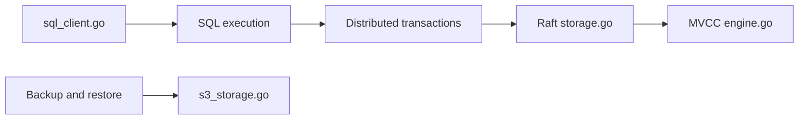

# cockroachdb/cockroach

> Distributed, fault-tolerant, PostgreSQL-compatible SQL database for applications that must scale.

## The problem
A single-node SQL database hits a ceiling and goes down with its machine. Replicating and rebalancing by hand is heavy.

## What it actually does
Exposes a SQL API (PostgreSQL protocol) on top of a key-value store replicated by Raft, with strongly consistent ACID transactions. Scales horizontally and survives disk, machine, rack or datacenter failures. Also handles backup/restore, changefeeds, cross-cluster replication, cloud storage (S3) and job tracking.

## How it is wired


## Trying it
```bash
# Aucune commande shell dans ce README : installer un exécutable précompilé
# ou compiler depuis les sources (voir le wiki), démarrer un cluster local,
# puis s'y connecter avec le client SQL intégré.
```

## Cost and gotchas
A managed offering (CockroachCloud) exists, with a free cluster. Since November 18, 2024 (v24.3 and later), versions are released under the CockroachDB Software License (CSL), which GitHub does not recognize.

## What it is not
It is not classic free software: recent versions fall under a house license. Nor is it an analytical database.

## Alternatives
Not documented: the README points to a comparison page without naming a repository.

## For you
Keep an eye on it: solid for distributed SQL, but read the CSL before any commercial use; a data/MLOps profile will rarely touch it directly.
