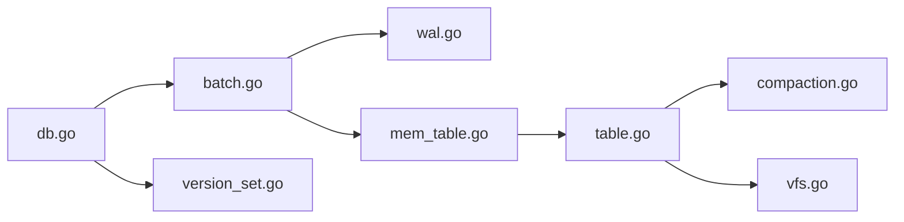

# cockroachdb/pebble

> LSM key-value engine in Go, inspired by RocksDB, the storage engine of CockroachDB.

## The problem
Embedding RocksDB in a Go program requires cgo and a huge feature surface of which only a part is used.

## What it actually does
Embedded LSM store: WAL, memtable, SSTables, versioned manifest, leveled compactions.
Indexed batches, snapshots, reverse iteration, bloom filters, range deletions, range keys, SSTable ingestion.
Major format versions with irreversible migrations.
`pebble` CLI to inspect, replay and benchmark a database.

## How it is wired


## Trying it
```bash
go run github.com/cockroachdb/pebble/cmd/pebble@v1.1.3 db upgrade <db-dir>
```
Normal usage is an `import "github.com/cockroachdb/pebble"` (Go example in the README).

## Cost and gotchas
Free. Can silently corrupt a RocksDB database that uses an unsupported feature.

## What it is not
Not a full RocksDB: no transactions, no column families, no backups. v2+ no longer opens RocksDB databases.

## Alternatives
- facebook/rocksdb: the original C++, far more complete.
- google/leveldb: the ancestor, simpler.

## For you
Ignore for a data/AI profile: an excellent engine, but it is only useful if you are writing a database yourself in Go.
