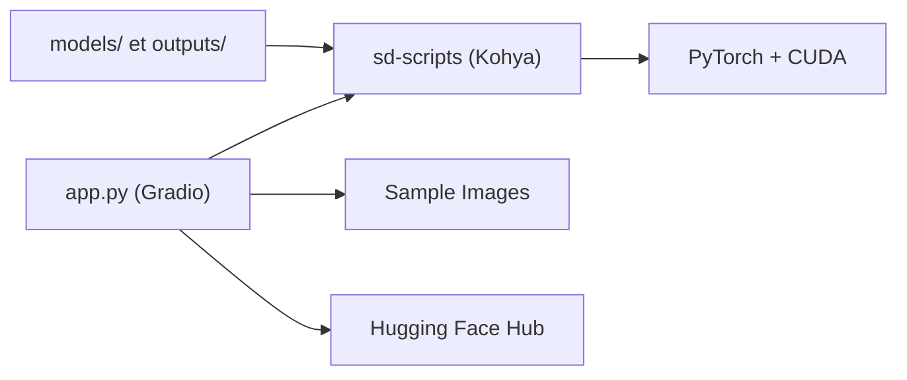

# cocktailpeanut/fluxgym

> Gradio web interface to train FLUX LoRAs on 12 to 20 GB GPUs, without a terminal.

## The problem
Kohya scripts train FLUX well but are driven from the command line; AI-Toolkit has a simple interface but requires 24 GB of VRAM.

## What it actually does
Gradio interface (derived from AI-Toolkit) on top of the `kohya-ss/sd-scripts` scripts (`sd3` branch). You enter the LoRA info, upload images and captions (or `.txt` files with the same name), then launch. Options: sample images every N steps, an advanced tab built from the Kohya flags, publishing to Hugging Face with a token stored in `HF_TOKEN`.

## How it is wired


## Trying it
```bash
git clone https://github.com/cocktailpeanut/fluxgym
cd fluxgym
git clone -b sd3 https://github.com/kohya-ss/sd-scripts
python -m venv env && source env/bin/activate
cd sd-scripts && pip install -r requirements.txt
cd .. && pip install -r requirements.txt
pip install --pre torch torchvision torchaudio --index-url https://download.pytorch.org/whl/cu121
python app.py
```

## Cost and gotchas
NVIDIA GPU required; PyTorch nightly mandated (cu128 for RTX 50). Docker possible (`docker compose up -d --build`). 414 open issues.

## What it is not
Not an image generator: it only trains LoRAs. Fragile reproducibility (depends on a branch and a nightly).

## Alternatives
AI-Toolkit (simpler but 24 GB) and the Kohya command-line scripts.

## For you
Watch: handy if you do local image fine-tuning, but your stack is not centered on image generation.
