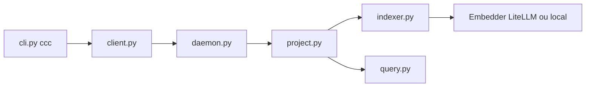

# cocoindex-io/cocoindex-code

> AST-based semantic code search, as a CLI, skill or MCP server for coding agents.

## The problem
Coding agents are poor at finding code from a description with grep and burn many tokens reading whole files.

## What it actually does
The `ccc` CLI splits files (by AST, customizable chunkers), computes embeddings and stores them in a SQLite index. A background daemon manages projects. Search by natural-language query, language/path filters, and `ccc grep` for structural search without an index. It integrates through a skill, a plugin (Claude Code, Grok, Oh My Pi) or MCP. Local embeddings (sentence-transformers) or cloud via LiteLLM.

## How it is wired


## Trying it
```bash
pipx install 'cocoindex-code[full]'
ccc init
ccc index
ccc search "authentication logic"
claude mcp add cocoindex-code -- ccc mcp
```

## Cost and gotchas
The `[full]` mode pulls about 1 GB (torch). Without it, an embedding API key is required. Anonymous telemetry is on by default; it can be disabled with `COCOINDEX_DISABLE_USAGE_TRACKING=1`. The daemon keeps the model in RAM. Changing models requires reindexing.

## What it is not
The "70% fewer tokens" claim is not demonstrated in the README. `ccc grep` depends on a CocoIndex feature not yet released: a local build is needed. On Docker for Mac, local inference is CPU-only.

## Alternatives
No alternative named in the README.

## For you
Adopt on trial: a local semantic index plugged in via MCP improves an agent's work on large repositories, with telemetry that is easy to switch off.
