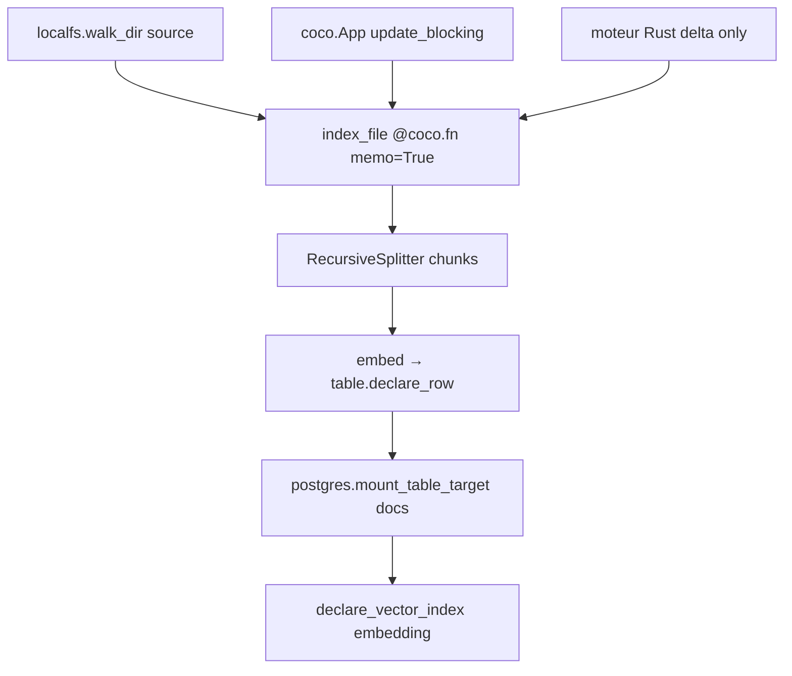

# cocoindex-io/cocoindex

> Declarative Python framework for incremental indexing, to keep a vector index always up to date.

## The problem
A RAG index goes stale as soon as the source changes, and reindexing everything on each cycle is expensive in embeddings.
Detecting the delta yourself, propagating it through joins and removing obsolete rows is a data-engineering job in its own right.

## What it actually does
You declare *what should be in* the target; the engine recomputes the delta and keeps the target in sync.
`@coco.fn(memo=True)` caches by hash of the input **and** hash of the code, so changing the function invalidates what needs to be.
Provided connectors and operators: `localfs.walk_dir`, `postgres.mount_table_target`, `RecursiveSplitter`, vector index declaration on a column.
When a source changes, it identifies the affected records, propagates through joins and lookups, updates the target and removes stale rows.

## How it is wired


## Trying it
```sh
pip install -U cocoindex
```

## Cost and gotchas
The library is free; you need a target, here PostgreSQL, so a service to host.
The README announces a CocoIndex Enterprise offering for scale: the functional boundary is not detailed.

## What it is not
Not a vector database: it writes into yours (PostgreSQL in the example).
Not an agent framework: it supplies fresh context, not orchestration.
Not pure Python: the core is in Rust, which limits what you can modify yourself.

## Alternatives
No alternative named; the README only cites its own connectors and a skill for coding agents.

## For you
The right answer to full reindexing: if you maintain a living RAG index, worth testing on a real corpus.
