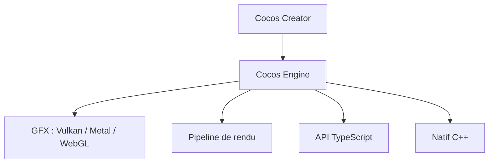

# cocos/cocos-engine

> Runtime engine of Cocos Creator for cross-platform 2D and 3D games, in C++ and TypeScript.

## The problem
Shipping the same game on mobile, web and mini-games requires a portable engine with an editor.

## What it actually does
Runtime engine half C++, half TypeScript: graphics (Vulkan, Metal, WebGL), customizable render pipeline, physically based rendering (PBR), animation, physics, particles and UI. It is designed to integrate with the Cocos Creator editor.

## How it is wired
Simplified diagram based on the fiche, no diagram provided.



## Trying it
```bash
npm install
npm run build
```

## Cost and gotchas
Free. Node.js and gulp-cli are required; native development has its own README. The license is not identified by GitHub.

## What it is not
Not usable on its own: the README states that it is the editor's runtime library, not intended for standalone use.

## Alternatives
No alternative named in the README.

## For you
Ignore: game engine, unrelated to data, AI or MLOps work.
