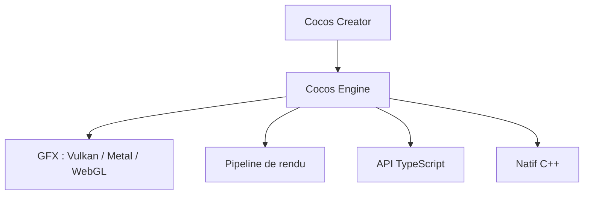

# cocos/cocos-engine

> Moteur d'exécution de Cocos Creator pour jeux 2D et 3D multiplateformes, en C++ et TypeScript.

## Le problème
Publier un même jeu sur mobile, web et mini-jeux demande un moteur portable avec un éditeur.

## Ce que ça fait vraiment
Moteur d'exécution moitié C++, moitié TypeScript : graphismes (Vulkan, Metal, WebGL), pipeline de rendu personnalisable, rendu physique (PBR), animation, physique, particules et interface. Il est conçu pour s'intégrer à l'éditeur Cocos Creator.

## Comment c'est branché
Schéma simplifié d'après la fiche, sans diagramme fourni.



## Essayer
```bash
npm install
npm run build
```

## Coût et pièges
Gratuit. Node.js et gulp-cli sont requis ; le développement natif a son propre README. La licence n'est pas identifiée par GitHub.

## Ce que ce n'est pas
Pas utilisable seul : le README précise que c'est la bibliothèque d'exécution de l'éditeur, non destinée à un usage indépendant.

## Alternatives
Aucune alternative nommée dans le README.

## Pour toi
À ignorer : moteur de jeu, sans lien avec le travail data, IA ou MLOps.

