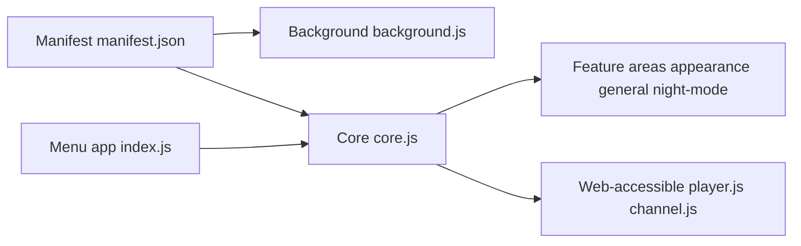

# code-charity/youtube

> Browser extension that adds about 80 settings to the YouTube interface.

## The problem
The YouTube interface offers no fine-grained control over the player, appearance or content filtering.

## What it actually does
A manifest loads a `background.js`, content scripts (`core.js`, `init.js`) and modules per area of YouTube, plus page-accessible scripts (`player.js`, `blocklist.js`, `themes.js`). A settings menu is built on the in-house Satus library. Translations are handled through Crowdin.

## How it is wired

## Trying it
No command documented in the README provided.

## Cost and gotchas
Free. The license is present but not recognized by GitHub. 1,484 open issues. Depends on changes to the YouTube interface.

## What it is not
It is not a downloader. The README is mostly slogans ("only YouTube extension you'll ever need") and has very little technical content.

## Alternatives
No alternative named in the README.

## For you
Ignore: a comfort improvement for YouTube, unrelated to your data/AI work.
