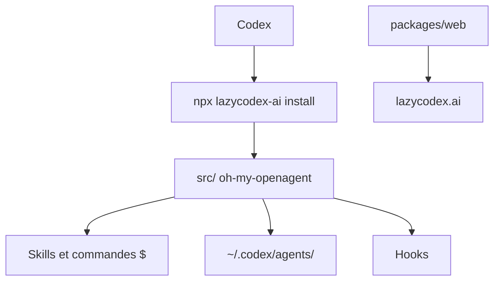

# code-yeongyu/lazycodex

> OmO distribution for Codex: project memory, planning, execution and verification, for Codex users.

## The problem
Codex alone lacks project memory, planning and a reliable end-of-task check on large repositories.

## What it actually does
Installs into Codex the commands `$ulw-plan`, `$start-work`, `$ulw-loop` and `$init-deep`, along with skills (review, LSP, AST-grep, rules), hooks and sub-agent roles (explorer, librarian, plan, momus, metis). Model routing picks a GPT model according to the task category. The repo is a thin layer; the engine is oh-my-openagent, as a submodule.

## How it is wired


## Trying it
```bash
npx lazycodex-ai install
npx lazycodex-ai doctor
npx lazycodex-ai uninstall
```

## Cost and gotchas
Consumes Codex and OpenAI API quotas; the README itself calls it a "token burner". Hooks require approval, to be renewed after each update. Autonomous mode (`--codex-autonomous`) is an explicit, risky choice.

## What it is not
Not an independent autonomous agent: it depends on Codex. The repo contains little code of its own, the engine being the OmO project.

## Alternatives
The README cites oh-my-codex as a source of inspiration for Ultragoal and UltraQA.

## For you
Worth watching: interesting if you already work in Codex on large repos, but costly in tokens and to be tested first on a throwaway project.
