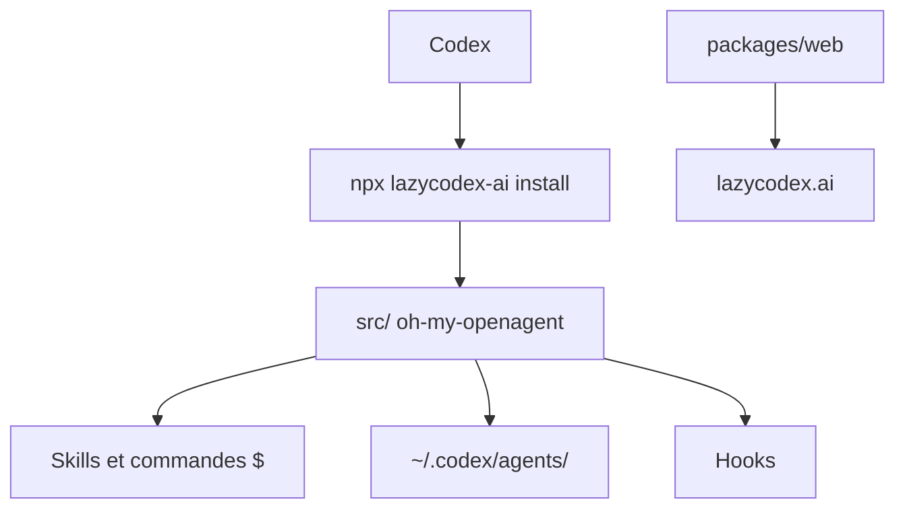

# code-yeongyu/lazycodex

> Distribution d'OmO pour Codex : mémoire de projet, planification, exécution et vérification, pour utilisateurs de Codex.

## Le problème
Codex seul manque de mémoire de projet, de planification et d'un contrôle de fin de tâche fiable sur de gros dépôts.

## Ce que ça fait vraiment
Installe dans Codex des commandes `$ulw-plan`, `$start-work`, `$ulw-loop` et `$init-deep`, ainsi que des skills (revue, LSP, AST-grep, règles), des hooks et des rôles de sous-agents (explorer, librarian, plan, momus, metis). Le routage de modèles choisit un modèle GPT selon la catégorie de tâche. Le dépôt est une couche fine ; le moteur est oh-my-openagent, en sous-module.

## Comment c'est branché


## Essayer
```bash
npx lazycodex-ai install
npx lazycodex-ai doctor
npx lazycodex-ai uninstall
```

## Coût et pièges
Consomme des quotas Codex et d'API OpenAI ; le README parle lui-même d'un « token burner ». Les hooks demandent une approbation, à renouveler après chaque mise à jour. Le mode autonome (`--codex-autonomous`) est un choix explicite à risque.

## Ce que ce n'est pas
Pas un agent autonome indépendant : il dépend de Codex. Le dépôt contient peu de code propre, le moteur étant le projet OmO.

## Alternatives
Le README cite oh-my-codex comme source d'inspiration pour Ultragoal et UltraQA.

## Pour toi
À surveiller : intéressant si tu travailles déjà dans Codex sur de gros dépôts, mais coûteux en tokens et à tester d'abord sur un projet jetable.

