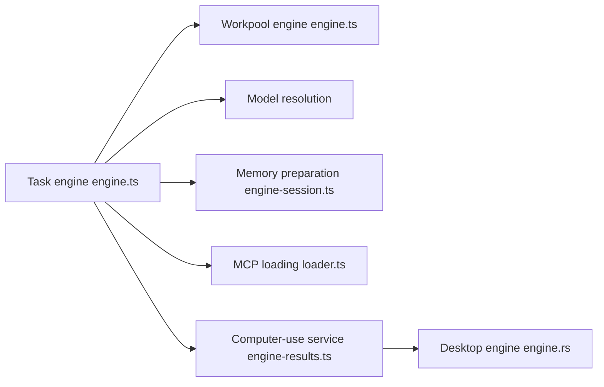

# code-yeongyu/oh-my-openagent

> The `omo` command orchestrates multi-model code agents with memory and specific skills.

## The problem
An individual agent fails to consider the broader context, mixes up different approaches without a clear method, and requests that someone take over the more complex tasks.

## What it actually does
Provides a binary `omo` based on Senpi (a fork of Pi). The `ultrawork`/`ulw` keyword initiates code reading, planning, and verification; `mass ulw` distributes the work using an agent graph. The memory is a Git repository of Markdown files. Connection via `/login` to Claude, ChatGPT, Kimi, and GLM subscriptions. The code demonstrates task engines, model solving, and a desktop engine (computer use) for macOS, X11, Wayland, and Windows.

## How it is wired


## Trying it
```bash
curl -fsSL https://get.omo.dev/install.sh | bash
omo
omo setup
omo doctor
```

## Cost and gotchas
Models and subscriptions are your responsibility. The installation script comes from a third-party domain (`get.omo.dev`), with backups on GitHub Releases. The license is present but not identified by GitHub.

## What it is not
Not a library: an opinion platform. The reviews in the README are testimonials, not measurements. The README states that it has no affiliation with the models mentioned.

## Alternatives
The README mentions OpenCode and LazyCodex as older versions, and oh-my-codex as a source of inspiration.

## For you
Things to watch out for: Interesting for testing multi-model orchestration, but licensing needs clarification, and the project should be managed by one person before being used in a team setting.
