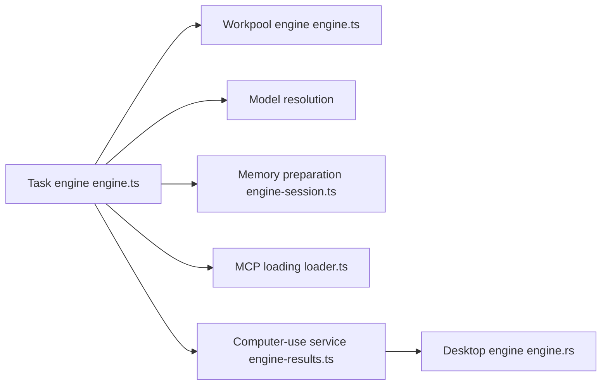

# code-yeongyu/oh-my-openagent

> Commande `omo` qui orchestre des agents de code multi-modèles avec mémoire et compétences.

## Le problème
Un agent seul oublie le contexte, mélange les modèles sans méthode et demande qu'on reprenne la main sur les tâches longues.

## Ce que ça fait vraiment
Fournit un binaire `omo` basé sur senpi (fork de pi). Le mot-clé `ultrawork`/`ulw` lance lecture du code, plan et vérification ; `mass ulw` répartit le travail en graphe d'agents. La mémoire est un dépôt git de fichiers markdown. Connexion par `/login` aux abonnements Claude, ChatGPT, Kimi, GLM. Le code montre moteurs de tâches, résolution de modèles et un moteur de bureau (computer use) pour macOS, X11, Wayland, Windows.

## Comment c'est branché


## Essayer
```bash
curl -fsSL https://get.omo.dev/install.sh | bash
omo
omo setup
omo doctor
```

## Coût et pièges
Modèles et abonnements à ta charge. Le script d'installation vient d'un domaine tiers (`get.omo.dev`), avec repli sur GitHub Releases. La licence est présente mais non identifiée par GitHub.

## Ce que ce n'est pas
Pas une bibliothèque : une application d'opinion. Les avis du README sont des témoignages, pas des mesures. Le README dit n'avoir aucune affiliation avec les modèles cités.

## Alternatives
Le README évoque l'édition OpenCode et LazyCodex comme anciennes versions, et oh-my-codex comme source d'idées.

## Pour toi
À surveiller : intéressant pour tester l'orchestration multi-modèles, mais licence à clarifier et projet porté par une personne avant tout usage en équipe.

