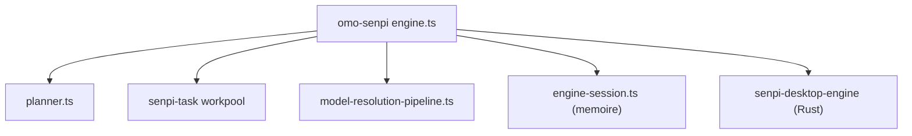

# code-yeongyu/oh-my-opencode

> A command-line agent that orchestrates multiple models and sub-agents to perform complex tasks.

## The problem
A lone coder forgets the context, makes mistakes, and demands that someone else take over.

## What it actually does
The `omo` command schedules tasks, distributes them in parallel to a pool of workers, selects a model per category (Claude subscriptions, ChatGPT, Kimi, GLM), loads skills and rules, and maintains a memory in the form of a Git repository of Markdown files. `ultrawork` and `mass ulw` trigger an agent graph. Computer use is experimental, with a Rust engine.

## How it is wired


## Trying it
```bash
curl -fsSL https://get.omo.dev/install.sh | bash
omo
omo setup
omo doctor
```

## Cost and gotchas
Burns tokens ("mass ulw"): subscriptions or keys are your responsibility. The `curl | bash` script installs a binary. The bug report `/bug` sends logs, configuration, and credentials; sending an installation identifier is linked to telemetry. 2,417 open issues.

## What it is not
Not affiliated with the models it uses (this is stated in the README). License is present but not identified by GitHub. The README claims significant gains (testimonials) without any published metrics.

## Alternatives
oh-my-codex: Source of ideas for Ultragoal and UltraQA, reimplemented for OmO (mentioned in the README).

## For you
Things to watch out for: Interesting for testing multi-agent orchestration, but token costs. It downloads a binary using curl|bash, and the licensing terms need to be clarified before any commercial use.
