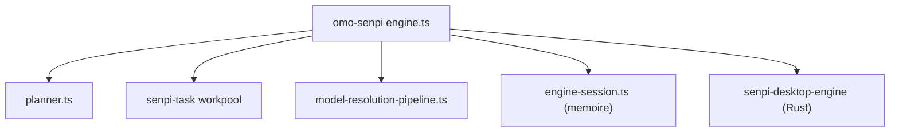

# code-yeongyu/oh-my-opencode

> Agent de code en ligne de commande qui orchestre plusieurs modèles et sous-agents pour mener des tâches à terme.

## Le problème
Un agent de code seul oublie le contexte, se trompe de modèle et exige qu'on le reprenne en main.

## Ce que ça fait vraiment
La commande `omo` planifie les tâches, les distribue en parallèle à un pool de workers, choisit un modèle par catégorie (abonnements Claude, ChatGPT, Kimi, GLM), charge skills et règles, et garde une mémoire sous forme de dépôt git de fichiers markdown. `ultrawork` et `mass ulw` déclenchent un graphe d'agents. Computer use est expérimental, avec un moteur Rust.

## Comment c'est branché


## Essayer
```bash
curl -fsSL https://get.omo.dev/install.sh | bash
omo
omo setup
omo doctor
```

## Coût et pièges
Brûle des tokens (« mass ulw ») : abonnements ou clés à ta charge. Le script `curl | bash` installe un binaire. Le rapport de bug `/bug` envoie journaux, config et identifiants ; l'envoi d'un identifiant d'installation est lié à la télémétrie. 2 417 issues ouvertes.

## Ce que ce n'est pas
Pas affilié aux modèles qu'il utilise (le README le précise). Licence présente mais non identifiée par GitHub. Le README annonce des gains forts (témoignages) sans mesure publiée.

## Alternatives
oh-my-codex : source des idées Ultragoal et UltraQA, réimplémentées pour OmO (cité dans le README).

## Pour toi
À surveiller : intéressant pour tester l'orchestration multi-agents, mais coût en tokens, télécharge un binaire par curl|bash et licence à clarifier avant tout usage pro.

