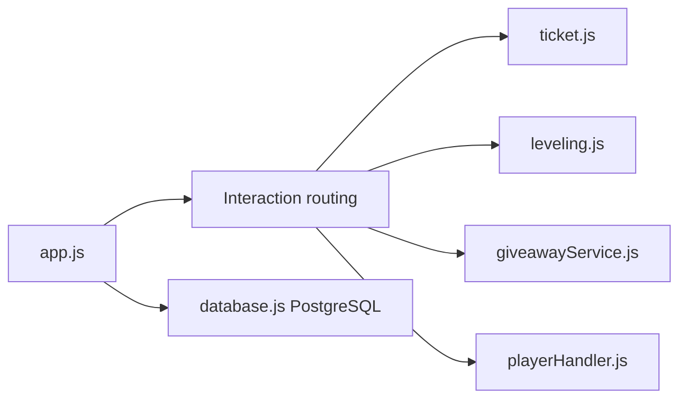

# codebymitch/TitanBot

> All-in-one Discord bot: moderation, economy, tickets, levels, music, for server administrators.

## The problem
Running a Discord server means juggling several bots for moderation, tickets, levels and announcements.

## What it actually does
A single Node.js bot covers moderation (mass actions, notes, cases), economy and shop, tickets with transcripts, server counters, reaction roles, XP and level roles, giveaways, birthdays, welcome messages and music via Lavalink. Data is isolated per server in PostgreSQL.

## How it is wired


## Trying it
```bash
git clone https://github.com/codebymitch/TitanBot.git
cd TitanBot
cp .env.example .env
docker compose up -d --build
curl http://localhost:3000/health
```

## Cost and gotchas
Discord bot token (`DISCORD_TOKEN`, `CLIENT_ID`, `GUILD_ID`); PostgreSQL included via Docker. Music uses public third-party Lavalink nodes by default. Extended intents and permissions are requested, including banning and managing roles.

## What it is not
Not a data or AI project. Global commands can take about an hour to propagate.

## Alternatives
Not documented: the README only cites Musicify as a point of comparison for music.

## For you
Ignore: off-topic for a data/AI/MLOps profile, single maintainer, and very broad Discord permissions.
