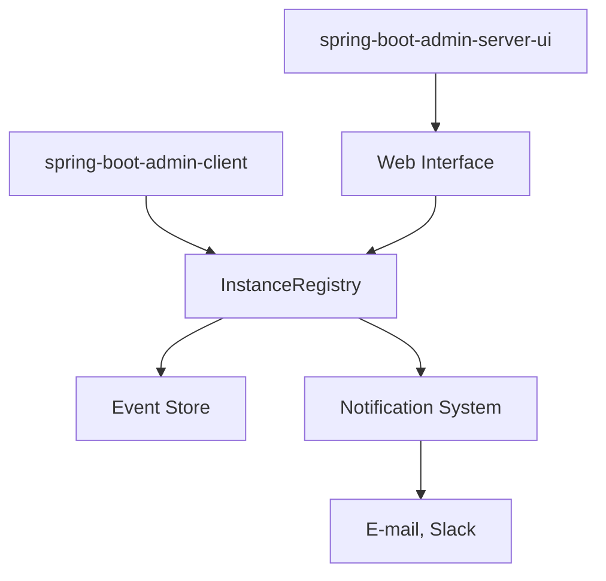

# codecentric/spring-boot-admin

> Web dashboard to monitor and manage Spring Boot applications through their actuator endpoints.

## The problem
Actuator's runtime data is reachable through REST or JMX, but tedious to consult by hand.

## What it actually does
Displays health, metrics, logs, environment variables, threads, HTTP traces and JMX beans of registered applications. Several applications can be followed from one server. A client registers with the server; the server polls the Actuator endpoints. Notifications are possible (e-mail, Slack) according to the provided diagram.

## How it is wired

## Trying it
No command documented in the supplied README: it points to the reference documentation. Only a Maven snapshot repository is given (XML fragment).

## Cost and gotchas
Free. Limited to the Java/Spring Boot ecosystem. Versions follow those of Spring Boot (3.x, 4.0, 4.1). The Actuator endpoints must be exposed: to be secured.

## What it is not
Not a general observability solution (no distributed tracing or advanced alerting documented) nor a tool for non-Spring code.

## Alternatives
No alternative named in the README.

## For you
Useful only if your serving services are in Spring Boot; for Python models, ignore it.
