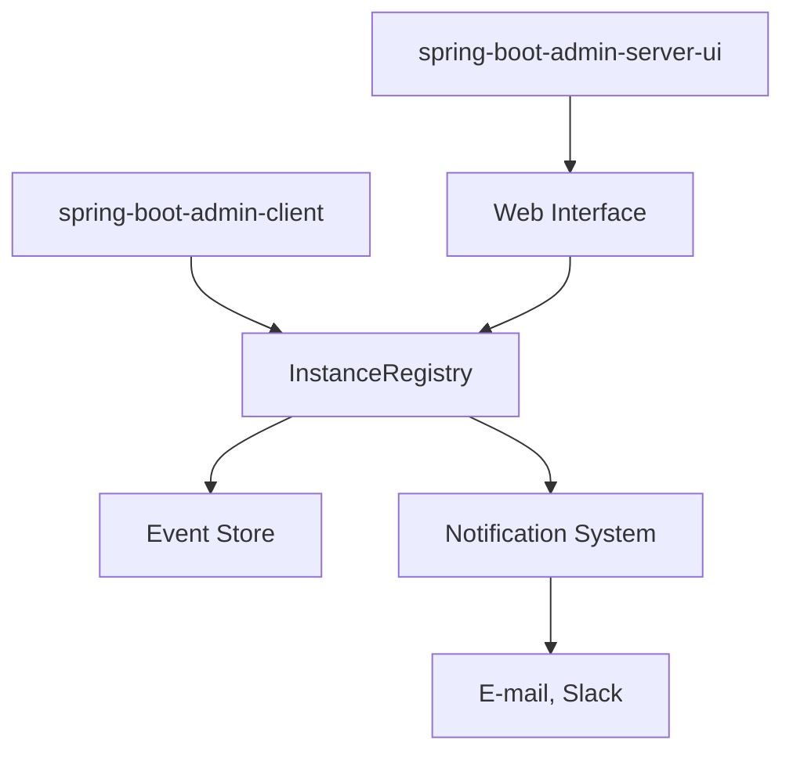

# codecentric/spring-boot-admin

> Tableau de bord web pour surveiller et gérer des applications Spring Boot via leurs endpoints actuator.

## Le problème
Les données d'exécution d'Actuator sont accessibles par REST ou JMX, mais pénibles à consulter à la main.

## Ce que ça fait vraiment
Affiche santé, métriques, logs, variables d'environnement, threads, traces HTTP et beans JMX d'applications enregistrées. Plusieurs applications peuvent être suivies depuis un serveur. Un client s'enregistre auprès du serveur ; le serveur interroge les endpoints Actuator. Notifications possibles (e-mail, Slack) selon le diagramme fourni.

## Comment c'est branché

## Essayer
Aucune commande documentée dans le README fourni : il renvoie à la documentation de référence. Seul un dépôt Maven de snapshots est donné (fragment XML).

## Coût et pièges
Gratuit. Réservé à l'écosystème Java/Spring Boot. Les versions suivent celles de Spring Boot (3.x, 4.0, 4.1). Il faut exposer les endpoints Actuator : à sécuriser.

## Ce que ce n'est pas
Ce n'est pas une solution d'observabilité générale (pas de traces distribuées ni d'alerting avancé documentés) ni un outil pour du code non Spring.

## Alternatives
Aucune alternative nommée dans le README.

## Pour toi
Utile seulement si tes services de serving sont en Spring Boot ; pour des modèles Python, c'est à ignorer.

