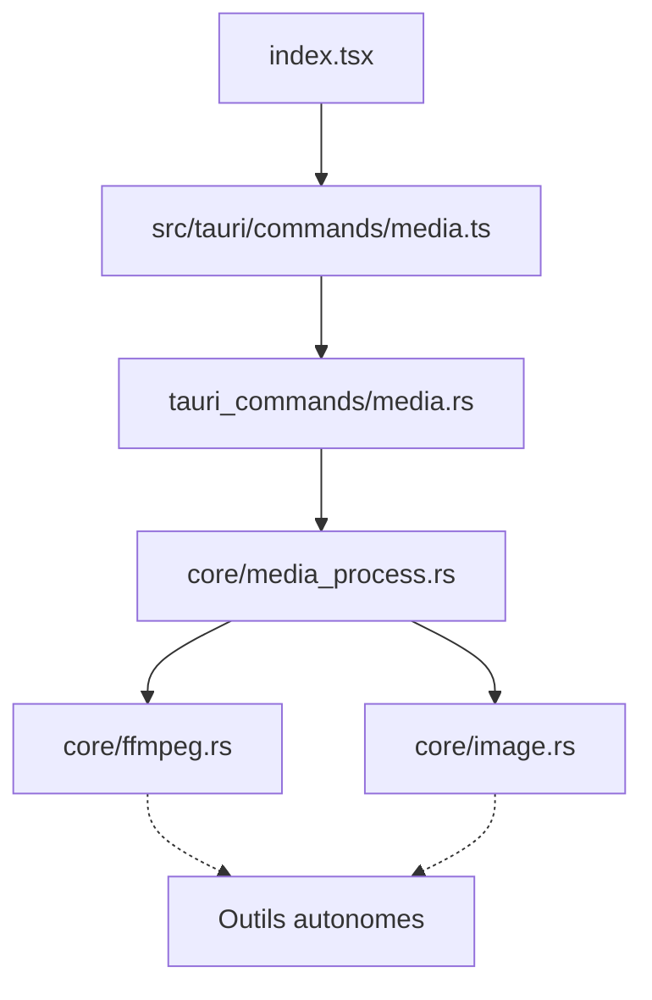

# codeforreal1/compressO

> Offline desktop application that compresses videos, images and audio, with a CLI and an MCP server.

## The problem
Reducing the size of media means juggling FFmpeg, pngquant, jpegoptim or gifski on the command line, each with its own options.

## What it actually does
A Tauri app (Rust + React) drives standalone binaries (FFmpeg, pngquant, jpegoptim, gifski) to compress files dropped into the window. You set the output, crop or transform, compress in batch, compare, then save. The `compresso` command and an MCP server (`compress`, `list_presets`, `cancel_compression`) do the same from a terminal or an agent. No network requests apart from updates.

## How it is wired


## Trying it
```bash
brew install --cask codeforreal1/tap/compresso
# développement
pnpm tauri:dev
pnpm vite:dev
pnpm tauri:build
```

## Cost and gotchas
Free. Application not notarized by Apple: Gatekeeper warning, to be bypassed through Homebrew or `xattr -cr /Applications/CompressO.app`. On Linux, the AppImage may show a blank screen without `WEBKIT_DISABLE_DMABUF_RENDERER=1`.

## What it is not
Not a compression engine: everything relies on third-party tools. Not a library or a service: it is a desktop app, even though the MCP lets an agent call it.

## Alternatives
No alternative named in the README.

## For you
Watch: handy for slimming down image or video datasets, and the MCP is a useful curiosity for agents, but it is not an MLOps pipeline tool.
