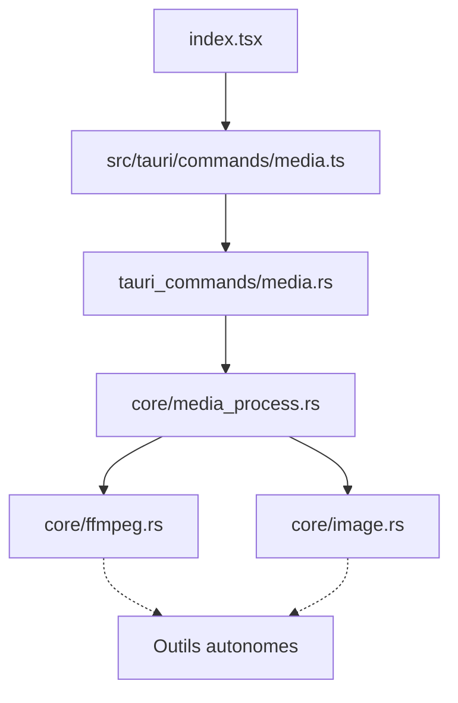

# codeforreal1/compressO

> Application de bureau hors ligne qui compresse vidéos, images et audio, avec CLI et serveur MCP.

## Le problème
Réduire le poids de médias demande de jongler avec FFmpeg, pngquant, jpegoptim ou gifski en ligne de commande, chacun avec ses options.

## Ce que ça fait vraiment
Une app Tauri (Rust + React) pilote des binaires autonomes (FFmpeg, pngquant, jpegoptim, gifski) pour compresser des fichiers déposés dans la fenêtre. On règle la sortie, on rogne ou transforme, on compresse en lot, on compare puis on enregistre. La commande `compresso` et un serveur MCP (`compress`, `list_presets`, `cancel_compression`) font la même chose depuis un terminal ou un agent. Aucune requête réseau hors mises à jour.

## Comment c'est branché


## Essayer
```bash
brew install --cask codeforreal1/tap/compresso
# développement
pnpm tauri:dev
pnpm vite:dev
pnpm tauri:build
```

## Coût et pièges
Gratuit. Application non notarisée par Apple : message de Gatekeeper, à contourner par Homebrew ou `xattr -cr /Applications/CompressO.app`. Sous Linux, l'AppImage peut afficher un écran blanc sans `WEBKIT_DISABLE_DMABUF_RENDERER=1`.

## Ce que ce n'est pas
Pas un moteur de compression : tout repose sur des outils tiers. Pas une bibliothèque ni un service : c'est une app de bureau, même si le MCP permet de l'appeler depuis un agent.

## Alternatives
Aucune alternative nommée dans le README.

## Pour toi
Surveiller : pratique pour alléger des jeux de données images ou vidéo, et le MCP est une curiosité utile pour agents, mais ce n'est pas un outil de pipeline MLOps.

