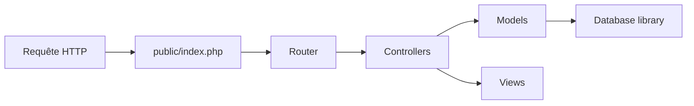

# codeigniter4/CodeIgniter4

> Full-featured, lightweight PHP web framework, for PHP developers building applications.

## The problem
Building a PHP web app requires routing, a database layer, sessions, caching and basic security.

## What it actually does
An MVC structure with a front controller `public/index.php`, a core (`system`) with autoloader, router, cache, session, database, encryption and a debug toolbar, and an `app` folder for your controllers, models and views. Requires PHP 8.2 or later with `intl` and `mbstring`. Developed by volunteers.

## How it is wired

## Trying it
No command in the README: it refers to the user guide.

## Cost and gotchas
Free. The web server must point to `public/`, otherwise the code is exposed. PHP 8.1 has been end-of-life since late 2025.

## What it is not
Not a data tool. Issues are for bugs only; support and feature requests go to the forum.

## Alternatives
No alternative named in the README.

## For you
Ignore: a PHP framework unrelated to your data/AI/MLOps work.
