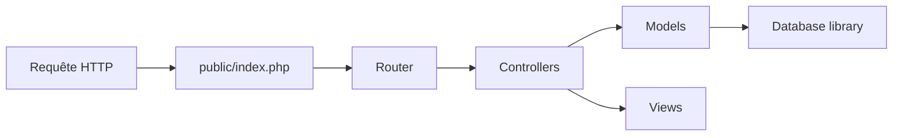

# codeigniter4/CodeIgniter4

> Framework web PHP complet, léger, pour développeurs PHP qui construisent des applications.

## Le problème
Construire une appli web PHP demande routage, base de données, sessions, cache et sécurité de base.

## Ce que ça fait vraiment
Structure MVC avec un contrôleur frontal `public/index.php`, un cœur (`system`) avec autoloader, routeur, cache, session, base de données, chiffrement et barre de débogage, et un dossier `app` pour tes contrôleurs, modèles et vues. Exige PHP 8.2 ou plus avec `intl` et `mbstring`. Développé par des bénévoles.

## Comment c'est branché

## Essayer
Aucune commande dans le README : renvoi au guide utilisateur.

## Coût et pièges
Gratuit. Le serveur web doit pointer sur `public/`, sinon le code est exposé. PHP 8.1 est en fin de vie depuis fin 2025.

## Ce que ce n'est pas
Pas un outil data. Les issues ne sont que pour bugs ; support et demandes de fonctionnalités vont au forum.

## Alternatives
Aucune alternative nommée dans le README.

## Pour toi
À ignorer : framework PHP sans lien avec ton travail data/IA/MLOps.

