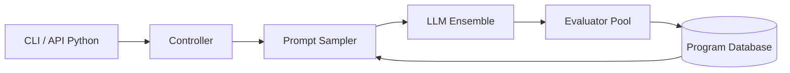

# codelion/openevolve

> Evolutionary coding agent that has LLMs improve a program according to an evaluator.

## The problem
Optimizing an algorithm or a kernel requires many manual trials guided by measurements.

## What it actually does
AlphaEvolve-inspired loop: prompt sampling from past programs, generation by an ensemble of LLMs, evaluation by your evaluator, storage in a MAP-Elites database with several islands. The artifacts (stderr, feedback) feed the next generation. Reproducible via a seed. Examples: function minimization, Metal kernels, Rust sorting, symbolic regression, prompt optimization.

## How it is wired


## Trying it
```bash
pip install openevolve
python openevolve-run.py examples/function_minimization/initial_program.py \
  examples/function_minimization/evaluator.py \
  --config examples/function_minimization/config.yaml \
  --iterations 50
```

## Cost and gotchas
The README estimates $0.01 to $0.60 per iteration depending on the model, at your expense; local models are possible. You have to write a reliable evaluator. The gains (2.8×, +23% accuracy) are the author's own.

## What it is not
Not guaranteed autonomous discovery: quality depends on the system message and the evaluator. The README uses a promotional tone, not carried over here.

## Alternatives
OptiLLM is cited as a complementary proxy, not as a competitor.

## For you
Worth watching: useful for measurable code or prompt optimization, if you can write a good evaluator and budget the calls.
