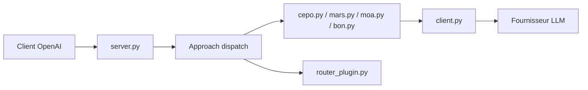

# codelion/optillm

> OpenAI API-compatible proxy that applies inference-time reasoning techniques to improve answers.

## The problem
Improving the accuracy of an existing LLM (math, code, logic) without retraining it.

## What it actually does
A local server receives requests in OpenAI format and applies a technique chosen by model prefix (`moa-gpt-4o-mini`), by the `optillm_approach` field or by a tag in the prompt: MARS, CePO, PlanSearch, best-of-N, MCTS, self-consistency, etc. Plugins add memory, privacy (anonymization), URL reading, code execution, an MCP client and deep research. It goes through LiteLLM for other providers and includes a local inference server.

## How it is wired


## Trying it
```bash
pip install optillm
export OPENAI_API_KEY="your-key-here"
optillm
```
Then point an OpenAI client at `http://localhost:8000/v1` with a prefixed model (`moa-gpt-4o-mini`).

## Cost and gotchas
Each technique multiplies the calls to the model, hence the bill. By default, the server listens locally (`127.0.0.1`); `--host 0.0.0.0` requires an `--optillm-api-key` key. Anthropic, llama.cpp and ollama do not accept multiple responses, which limits the available techniques.

## What it is not
Not a guarantee of improvement: the README results are the author's, on specific benchmarks, and not all reproduced by third parties.

## Alternatives
- LiteLLM: proxy for providers not compatible with OpenAI, cited in the README.

## For you
Worth watching: useful for testing reasoning strategies on your own evaluations, measuring the token overhead before believing in it.
