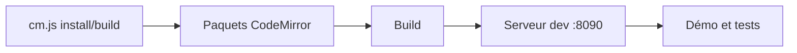

# codemirror/dev

> CodeMirror's development repository: bug tracking and scripts for working on its packages.

## The problem
CodeMirror is split into many npm packages; contributing means cloning and building them together.

## What it actually does
`bin/cm.js install` clones the packages, installs dependencies and compiles; `bin/cm.js build` rebuilds everything; `npm run dev` starts a server (port 8090) with a demo and browser tests. The README announces the move to code.haverbeke.berlin; this repository is archived.

## How it is wired


## Trying it
```bash
node bin/cm.js install
node bin/cm.js build
npm run dev
```

## Cost and gotchas
Free; Node 16 required. Archived repository: no more updates here. License present but not identified.

## What it is not
It is not for using CodeMirror: the README says to install the separate npm packages.

## Alternatives
The new announced repository: https://code.haverbeke.berlin/codemirror/dev.

## For you
Ignore: archived and moved repository, and a web code editor is out of scope.
