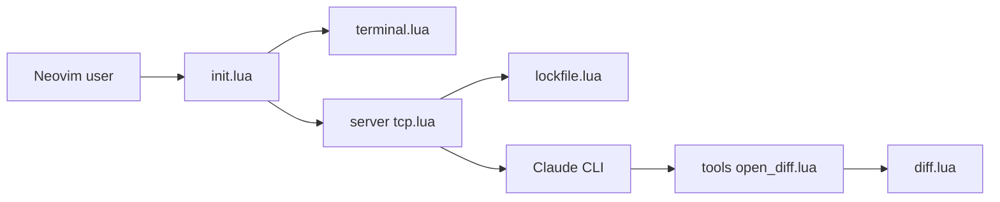

# coder/claudecode.nvim

> Pure-Lua Neovim plugin that hooks Claude Code into the editor, for Neovim users.

## The problem
Claude Code only has official integrations for VS Code and JetBrains. Under Neovim, the CLI sees neither the current file, nor the selection, nor the diagnostics.

## What it actually does
The plugin hosts a WebSocket server (an MCP variant) inside Neovim and writes a lock file `~/.claude/ide/[port].lock` so the CLI can discover it. Claude can then open files, read the selection and diagnostics, and propose native diffs accepted with `:w` or rejected with `:q`. The terminal can be embedded (snacks, native), external or absent.

## How it is wired


## Trying it
```lua
{
  "coder/claudecode.nvim",
  dependencies = { "folke/snacks.nvim" },
  config = true,
}
```
```vim
:ClaudeCode
:'<,'>ClaudeCodeSend
```

## Cost and gotchas
The Claude Code CLI must be installed (so an Anthropic account or API key at your expense) and `snacks.nvim` for the enriched terminal. With a local install or native binary, set `terminal_cmd`.

## What it is not
It is not an agent: it only connects the editor to the CLI. Auto-save plugins can accept diffs too quickly unless an exclusion condition is set. The protocol is reverse-engineered, so it is exposed to changes on Anthropic's side.

## Alternatives
- carlos-algms/agentic.nvim: goes through the ACP protocol and supports many providers.

## For you
Adopt if you code in Neovim with Claude Code: company maintainer, recent activity (push of 2026-10-17), MIT license.
