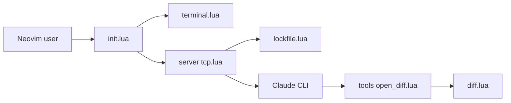

# coder/claudecode.nvim

> Plugin Neovim en Lua pur qui branche Claude Code sur l'éditeur, pour les utilisateurs de Neovim.

## Le problème
Claude Code n'a d'intégration officielle que pour VS Code et JetBrains. Sous Neovim, le CLI ne voit ni le fichier courant, ni la sélection, ni les diagnostics.

## Ce que ça fait vraiment
Le plugin héberge un serveur WebSocket (variante MCP) dans Neovim et écrit un fichier de verrouillage `~/.claude/ide/[port].lock` pour que le CLI le découvre. Claude peut alors ouvrir des fichiers, lire sélection et diagnostics, et proposer des diffs natifs acceptés par `:w` ou refusés par `:q`. Le terminal peut être intégré (snacks, native), externe ou absent.

## Comment c'est branché


## Essayer
```lua
{
  "coder/claudecode.nvim",
  dependencies = { "folke/snacks.nvim" },
  config = true,
}
```
```vim
:ClaudeCode
:'<,'>ClaudeCodeSend
```

## Coût et pièges
Il faut le CLI Claude Code installé (donc compte ou clé d'API Anthropic à ta charge) et `snacks.nvim` pour le terminal enrichi. Avec une installation locale ou binaire native, régler `terminal_cmd`.

## Ce que ce n'est pas
Ce n'est pas un agent : il ne fait que relier l'éditeur au CLI. Les plugins d'auto-save peuvent accepter les diffs trop vite sans condition d'exclusion. Le protocole est reverse-engineeré, donc exposé aux changements côté Anthropic.

## Alternatives
- carlos-algms/agentic.nvim : passe par le protocole ACP et supporte de nombreux fournisseurs.

## Pour toi
Adopter si tu codes sous Neovim avec Claude Code : mainteneur entreprise, activité récente (push du 2026-10-17), licence MIT.

