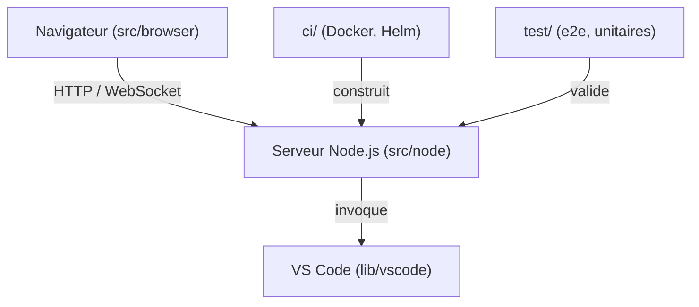

# coder/code-server

> Runs VS Code on a server and opens it in a browser, to develop from any device.

## The problem
A laptop or tablet is not enough to compile, test or download big things. Keeping the same environment everywhere is a pain.

## What it actually does
Node.js server that serves the VS Code interface to the browser over HTTP and WebSocket. It handles login, port proxying and serves the embedded VS Code code (`lib/vscode`). Heavy computation runs on the server. Dockerfiles and a Helm chart exist in `ci/`.

## How it is wired


## Trying it
```bash
curl -fsSL https://code-server.dev/install.sh | sh -s -- --dry-run
curl -fsSL https://code-server.dev/install.sh | sh
```

## Cost and gotchas
Free, but it needs a Linux machine with WebSockets, at least 1 GB of RAM and 2 vCPUs. The server is exposed: it must be protected.

## What it is not
Not a multi-user platform: to manage a team, the README points to coder/coder.

## Alternatives
- coder/coder: manage development environments for a whole team.

## For you
Adopt it: you code in the browser on a GPU server or a VM, without installing anything on your machine.
